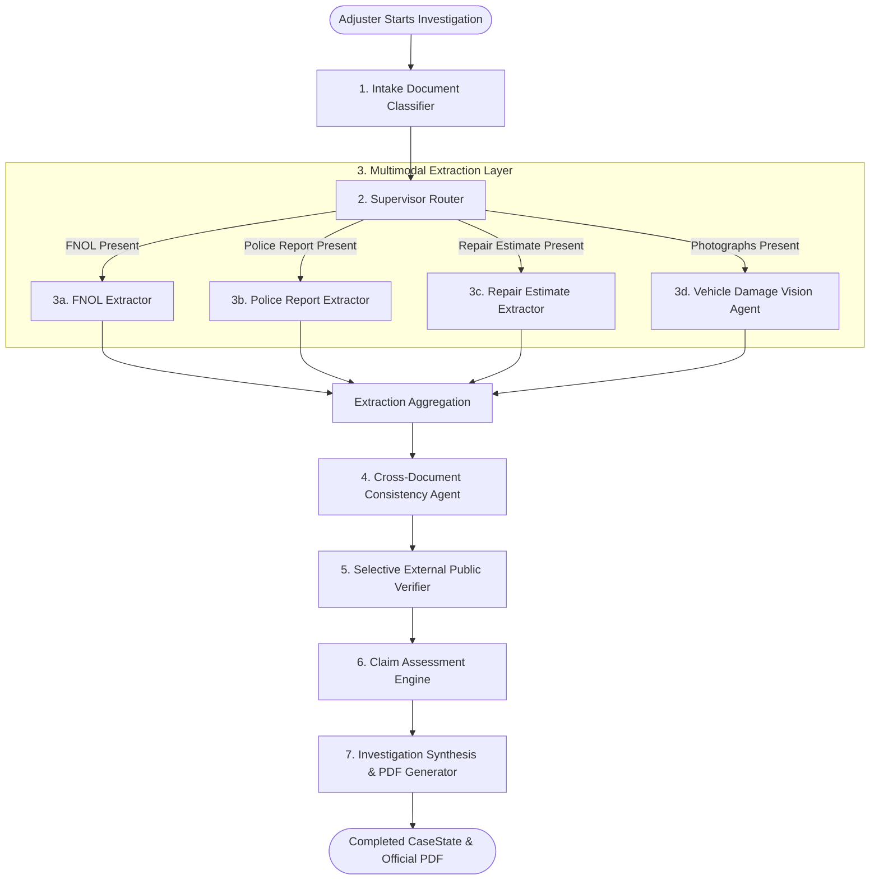

# ClaimScope — System Architecture & Agent Orchestration

## 1. Architectural Overview

ClaimScope is an enterprise-grade AI decision-support platform designed for Property & Casualty (P&C) auto insurance adjusters. It utilizes a decoupled, modern multi-tier architecture engineered for strict evidentiary provenance, explainability, and regulatory compliance.

```
+-----------------------------------------------------------------------------------+
|                            ADJUSTER WORKBENCH (Next.js 16)                        |
|   - 6-Tab Case Workspace (Documents, Extracted Facts, Vision, Discrepancies,     |
|     External Grounding, Investigation Report)                                     |
|   - Real-Time LangGraph Execution Stepper & Live Polling                          |
|   - 1-Click Synthetic Incident Package Sandbox (Cases A through E)               |
+------------------------------------------+----------------------------------------+
                                           | HTTP REST / JSON / Streaming PDF
+------------------------------------------v----------------------------------------+
|                            FASTAPI BACKEND SERVICE                                |
|   - Asynchronous RESTful Endpoints (/api/v1/cases, /documents, /reports)          |
|   - System & Gemini Diagnostic Endpoints (/api/v1/diagnostics/gemini)            |
|   - PyMuPDF Native Text & Vector Parsing Engine                                   |
|   - ReportLab 5.0 Vector PDF Generation Engine                                    |
|   - Async SQLAlchemy 2.0 ORM (SQLite / PostgreSQL)                                |
+------------------------------------------+----------------------------------------+
                                           | Orchestration State
+------------------------------------------v----------------------------------------+
|                      LANGGRAPH ADAPTIVE INVESTIGATION GRAPH                       |
|   - Dynamic StateGraph(CaseState) with Conditional Supervisor Routing             |
|   - Native Gemini Multimodal Extraction (google-genai SDK)                        |
|   - Hybrid Deterministic + Semantic Cross-Referencing                             |
|   - Selective External Public Verification (NHTSA, Open-Meteo, CCC Benchmarks)    |
|   - Explainable Adjuster Assessment Engine (TRG-MAT-01 to TRG-STR-08)             |
+-----------------------------------------------------------------------------------+
```

---

## 2. LangGraph Adaptive Multi-Agent Pipeline

The core investigative intelligence is orchestrated via a LangGraph `StateGraph(CaseState)` workflow. Unlike rigid linear pipelines that execute every tool regardless of input, ClaimScope dynamically inspects incoming incident packages and conditionally routes only the appropriate specialized extractors.



### Agent Node Responsibilities

| Stage | Node Function | Execution Condition | Primary Output |
|---|---|---|---|
| **1. Intake Classification** | `intake_classifier_node` | Mandatory on all cases | Content-based classification (`fnol`, `police_report`, `repair_estimate`, `photo`, `other`) |
| **2. Supervisor Routing** | `supervisor_router_node` | Mandatory on all cases | Dynamically selects downstream extraction targets; logs skipped stages |
| **3. Multimodal Extraction** | `fnol_agent_node`<br>`police_agent_node`<br>`estimate_agent_node`<br>`vision_agent_node` | Conditionally invoked based on document presence | Structured Pydantic extraction records with field-level provenance and confidence |
| **4. Cross-Referencing** | `consistency_agent_node` | Invoked when $\ge 2$ documents or photos exist | Pairwise matrix of narrative, VIN, date/time, and damage discrepancies |
| **5. External Verification** | `external_verifier_node` | Invoked when 17-char VIN, accident date/city, or repair lines exist | Authoritative grounding via NHTSA vPIC, Open-Meteo archives, and collision benchmarks |
| **6. Assessment Evaluation** | `assessment_node` | Mandatory on all cases | Rule evaluation (`TRG-MAT-01` to `TRG-STR-08`) and outcome categorization |
| **7. Investigation Synthesis** | `synthesis_node` | Mandatory on all cases | Standardized 11-section investigation report and ReportLab PDF document stream |

---

## 3. Shared State & Evidentiary Provenance Model

Every extracted fact in ClaimScope is immutable, traceable, and validated through Pydantic schemas. Fabricated or hallucinated values are strictly prohibited: missing information remains `None`.

### Provenance Wrapper Pattern (`FieldWithProvenance[T]`)
```python
class FieldWithProvenance(BaseModel, Generic[T]):
    value: Optional[T] = None
    confidence: Optional[float] = Field(None, ge=0.0, le=1.0)
    source_document: Optional[str] = None
    source_page: Optional[int] = None
    source_location: Optional[str] = None
    extraction_notes: Optional[str] = None
```

### LangGraph Workflow Shared State (`CaseState`)
```python
class CaseState(BaseModel):
    case_id: str
    case_number: str
    documents: List[DocumentInventoryItem] = []
    extractions: Dict[str, Any] = {}
    vision_observations: Dict[str, PhotoDamageAnalysis] = {}
    inconsistencies: List[InconsistencyFinding] = []
    web_verifications: List[WebVerificationResult] = []
    assessment: Optional[AssessmentResult] = None
    investigation_report: Optional[Dict[str, Any]] = None
    agent_executions: List[AgentExecutionRecord] = []
    missing_documents: List[str] = []
    errors: List[ProcessingError] = []
```

---

## 4. Assessment Rule Engine Architecture

ClaimScope utilizes a hybrid deterministic and explainable rule engine rooted in authentic US P&C insurance claims adjudication workflows.

```
                              [Inconsistencies & Verification Findings]
                                                 |
                                                 v
                       +---------------------------------------------------+
                       |           CLAIM ASSESSMENT ENGINE                 |
                       +---------------------------------------------------+
                               |                   |                   |
            TRG-MAT-01 / TRG-VIN-02      TRG-DOC-04 / TRG-EXT-06     0 Triggers
            Critical Discrepancies       Missing Info / Benchmarks   Mutually Corroborated
                               |                   |                   |
                               v                   v                   v
                     [ESCALATE FOR REVIEW]    [ADDITIONAL INFO]    [ROUTINE REVIEW]
                     Risk Score: 0.70-0.85    Risk Score: 0.45     Risk Score: 0.15
```

### Rule Definitions & Triggers

| Rule ID | Name | Trigger Condition | Severity | Standard Adjuster Protocol |
|---|---|---|---|---|
| `TRG-MAT-01` | Narrative & Liability Contradiction | Policyholder narrative directly contradicts police collision findings or citation | High / Critical | Order recorded statement; request CAD dispatch audio logs |
| `TRG-VIN-02` | Vehicle Identification Discrepancy | Mismatched VIN characters or plate numbers across forms | Critical | Verify physical VIN plate stamping and vehicle registration title |
| `TRG-SEV-03` | Stated vs. Visible Severity Mismatch | Reported minor plastic scuff contradicts deployed airbags or severe unibody crush | High | Assign field physical damage appraiser for structural inspection |
| `TRG-DOC-04` | Missing Core Package Records | Package lacks official police report or certified body shop estimate | Medium | Issue request letter for required casualty documentation |
| `TRG-TIM-05` | Temporal Reporting Anomaly | Reported crash timestamp contradicts official officer dispatch records | Medium | Cross-reference policy inception window against CAD dispatch log |
| `TRG-EXT-06` | External Registry Conflict | NHTSA vPIC decode contradicts reported vehicle year/make/model | High | Request factory build sheet and state DMV registration renewal card |
| `TRG-STR-08` | Structural Damage Exposure | Photographs indicate possible frame horn, rail, or unibody crumple | High | Direct vehicle to certified collision facility for frame bench teardown |

---

## 5. Security & Isolation Architecture

1. **Credential Isolation**: All LLM API calls are centralized exclusively in the FastAPI backend service (`app/services/llm_provider.py`). The frontend client never receives or stores API tokens.
2. **Local Storage Sanitization**: Uploaded filenames are sanitized and assigned non-colliding UUID prefixes before disk storage.
3. **No General Web Surfing Fabrication**: External verification endpoints query designated, free public government APIs (NHTSA vPIC) and meteorological archives (Open-Meteo). Gemini's internal weights are never disguised as retrieved web evidence.
4. **Human-in-the-Loop Guardrail**: All reports, UI views, and PDF exports include statutory disclaimers stating that ClaimScope is an assistive decision-support platform and does not perform unilateral claim denial or fraud determinations.
