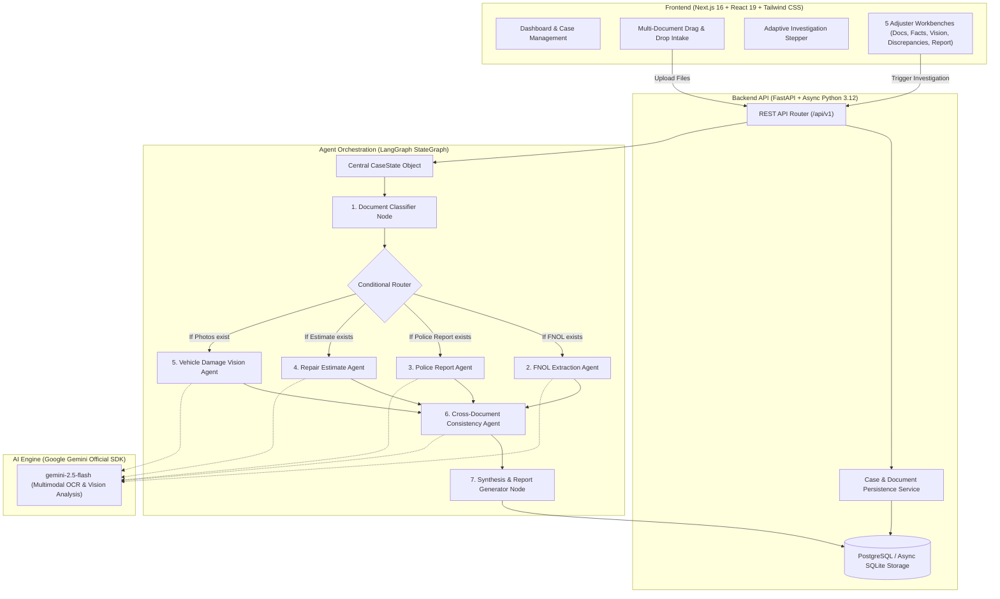

# ClaimScope — Project Master Architecture & Implementation Plan

> **Product:** ClaimScope — Auto Accident Claim Investigation Assistant  
> **Domain:** US Property & Casualty (P&C) Auto Insurance  
> **Target Persona:** Auto Claims Adjusters & SIU (Special Investigation Unit) Investigators  
> **Core Principle:** Assistive Human-in-the-Loop decision intelligence. ClaimScope **never** unilaterally approves, denies, or brands a claim fraudulent. Every insight and discrepancy is traceable directly to source evidence.

---

## 1. Executive Overview & Architecture

ClaimScope is a multimodal, evidence-driven, LangGraph-orchestrated insurance claim investigation platform designed specifically for the US P&C Auto market. It ingests mixed incident packages—including First Notice of Loss (FNOL) forms, official police accident reports, certified repair estimates, scanned/handwritten submissions, and scene/damage photographs—and executes an adaptive, conditional agent pipeline to extract structured facts, assess physical damage, verify consistency across disparate sources, and generate explainable investigation reports.

### High-Level System Architecture



---

## 2. Technology Stack & Design Principles

| Layer | Technology | Rationale |
|---|---|---|
| **Frontend Framework** | Next.js 16 (App Router, Turbopack, React 19) | Modern server/client rendering, type safety, production optimizations |
| **Styling & Icons** | Tailwind CSS + Lucide React | Restrained enterprise design system; zero extraneous decorative elements |
| **Backend API** | FastAPI (ASGI, Asyncio, Python 3.12) | High-performance asynchronous execution, auto OpenAPI generation |
| **Orchestration** | LangGraph (`StateGraph`) | Explicit, inspectable state machine with dynamic conditional edges |
| **Data Validation** | Pydantic v2 | Strict schema validation, provenance tracking, typed JSON serialization |
| **PDF Extraction** | PyMuPDF (`fitz`) | Fast native text and vector stream extraction with page rendering fallback |
| **AI Provider** | Google Gemini (`google-genai` SDK) | Single unified provider for text, multimodal OCR, and vision reasoning |
| **Persistence** | SQLAlchemy 2.0 (Async) + SQLite/Postgres | Clean repository pattern with async sessions and audit tracking |

---

## 3. Core Schemas & Provenance Framework

### Provenance Tracking: `FieldWithProvenance[T]`
To ensure strict regulatory compliance and human-in-the-loop accountability, extracted facts in ClaimScope wrap raw values in a generic provenance container:

```python
class FieldWithProvenance(BaseModel, Generic[T]):
    value: Optional[T] = None
    confidence: Optional[float] = Field(None, ge=0.0, le=1.0)
    source_document: Optional[str] = None
    source_page: Optional[int] = None
    source_text: Optional[str] = None
    extraction_notes: Optional[str] = None
```

### Shared `CaseState` Schema
The LangGraph pipeline passes a single mutable typed state across all specialized nodes:
- `case_id` & `case_number`: Immutable claim identifiers.
- `documents`: Document inventory with metadata, file size, format, and content-based classification.
- `extractions`: Keyed extractions mapped by document ID (`FNOLExtraction`, `PoliceReportExtraction`, `RepairEstimateExtraction`).
- `vision_observations`: Keyed photographic findings (`PhotoDamageAnalysis`) per image file.
- `inconsistencies`: Detected contradictions and discrepancy findings (`InconsistencyFinding`).
- `agent_executions`: Real-time lifecycle records (`AgentExecutionRecord`) with status tracking (`pending`, `completed`, `skipped`, `failed`, `unavailable`).
- `missing_documents`: Inventory of standard documentation missing from the uploaded package.
- `investigation_limitations`: Contextual alerts highlighting unanalyzed factors or image quality limitations.
- `processing_log`: ISO-timestamped audit trail of all graph operations.

---

## 4. Vehicle Damage Vision Rubric & Guardrails

The `VehicleDamageVisionAgent` analyzes submitted accident photographs using Google Gemini 2.5 Flash with strict insurance domain guardrails:

### Severity Classification Rubric
1. **Minor**: Superficial scratches, light paint transfer, minor scuffs, small bumper dents; no compromised structural integrity; vehicle remains safely driveable.
2. **Moderate**: Medium panel deformation, fractured bumper cover, cracked headlight/taillight assembly, dented quarter panel/fender; non-structural component replacement or cosmetic repair required.
3. **Severe**: Heavy intrusion, crushed radiator support, deployed airbags, compromised steering/suspension geometry, torn structural unibody/frame rails, non-driveable.
4. **Catastrophic / Total Loss**: Complete structural collapse, rollover intrusion, cab crush, complete front-end demolition, or severe burned shell exceeding projected vehicle market valuation.

### Anti-Hallucination Guardrails
- **No Micrometer Measurements**: The agent never claims exact millimeter or inch panel gap measurements from 2D images.
- **No Hidden Damage Speculation**: It explicitly states internal component conditions cannot be confirmed without physical teardown.
- **No Speed / Causation Attribution**: It never speculates on vehicle velocity at impact or definitively decides fault based on photos alone.
- **No Repair Dollar Estimates**: Financial cost estimation from raw photos is prohibited; repair figures are grounded solely in certified repair estimates.

---

## 5. Development Roadmap (Five Stages)

### Stage 1: Architectural Foundation & FNOL Ingestion *(Completed)*
- Clean Next.js + FastAPI decoupled repository structure.
- Database models for Cases, Documents, Evidences, and Reports.
- Native PDF ingestion and text extraction via PyMuPDF.
- Enterprise design system, navigation shell, and case intake workflows.
- Unit and integration tests for core schemas and CRUD operations.

### Stage 2: Multimodal Investigation Engine & Adaptive Agents *(Completed)*
- **Gemini-Only AI Integration**: Unified on `google-genai` official SDK with free-tier friendly defaults (`gemini-2.5-flash`), exponential backoff for rate limits, and clear `ConfigurationError` handling.
- **Content-Based Document Classifier**: Heuristic text analysis + Gemini multimodal fallback for classifying FNOLs, Police Reports, Repair Estimates, and Scene Photos.
- **Multimodal Document Processing**: Dedicated Pydantic extraction pipelines for police accident reports, auto body repair estimates, and handwritten/scanned documents.
- **Vehicle Damage Vision Agent**: Structured photograph analysis with an explainable damage rubric and guardrails.
- **Cross-Document Consistency Agent**: Deterministic discrepancy engine (VIN, date, plate validation) + Gemini semantic discrepancy engine (narrative and impact point contradiction detection).
- **LangGraph Dynamic Workflow**: Adaptive StateGraph execution that dynamically skips absent document types and logs omissions.
- **Synthetic Test Packages**: Automated generators for 5 test scenarios (A: Clean Minor, B: Staged Front/Rear Contradiction, C: Total Loss Rollover, D: FNOL Only, E: Hit-and-Run Unidentified).
- **Interactive Adjuster UI**: 5 dedicated workbench tabs (Incident Documents, Extracted Facts & Provenance, Vision Analysis, Discrepancies, Investigation Report) with real-time Stepper feedback.

### Stage 3: External Grounding, Weather & Geospatial Verification *(Upcoming)*
- Selective real-time external search integration for grounding suspicious facts.
- Historical weather API verification matching reported accident time/coordinates with actual atmospheric conditions (e.g., verifying "wet road / heavy rain" claims).
- Geospatial street-level validation for reported collision intersections.
- Market repair parts pricing and labor rate validation against regional benchmarks.

### Stage 4: Rule-Based Evaluation & SIU Fraud Risk Indicators *(Upcoming)*
- Explainable, deterministic rule engine evaluating claim risk factors:
  - Timing anomalies (e.g., policy inception within 72 hours of crash).
  - High discrepancy count between driver statement and police narrative.
  - Damage severity mismatch with described low-speed collision.
- Structured risk tier categorization: `Routine`, `Flag for Review`, `Escalate to SIU`.
- Adjuster override interface allowing human investigators to accept, modify, or dismiss automated findings.

### Stage 5: Final Production Polish, Export & Enterprise Security *(Upcoming)*
- Comprehensive PDF report export with institutional header and adjuster signature line.
- End-to-end regression test suite covering all synthetic packages.
- Docker containerization for one-command deployment.
- Role-based access control and production environment readiness.

---

## 6. Synthetic Test Package Scenarios

ClaimScope includes 5 synthetic incident packages located in `backend/synthetic_packages/`:

| Case | Title | Documents Included | Expected Engine Behavior |
|---|---|---|---|
| **Case A** | Clean Minor Parking Rear-End | FNOL, Police Report, Repair Estimate, 1 Photo | Consistent facts across all sources; `minor` damage; 0 discrepancies; routine processing. |
| **Case B** | Staged Front/Rear Contradiction | FNOL, Police Report, Repair Estimate, 2 Photos | High severity discrepancy detected: FNOL reports rear-end by third party, but Police Report and Damage Photos prove driver rear-ended a stationary flatbed; mismatched VIN suffix; flagged for review. |
| **Case C** | Highway Rollover Severe Loss | FNOL, Police Report, 2 Photos | `catastrophic_total_loss` vision severity; Repair Estimate skipped due to total loss; missing estimate noted; high severity flag. |
| **Case D** | Partial Intake — FNOL Only | FNOL Form Only | Adaptive routing skips Police, Estimate, and Vision nodes with `skipped` status; missing documents logged in report; preliminary recommendation. |
| **Case E** | Hit-and-Run Unidentified Vehicle | FNOL, Police Report, 1 Photo | Missing third-party identity; moderate damage; discrepancy in reported hit-and-run location vs. officer physical debris site. |

---

## 7. Configuration & Environment Setup

ClaimScope is pre-configured to operate on Google Gemini without requiring any paid subscription.

1. **Backend Environment** (`backend/.env`):
   ```bash
   APP_NAME="ClaimScope API"
   APP_VERSION="0.2.0"
   DEBUG=false
   
   # Database (defaults to async SQLite if Postgres is omitted)
   DATABASE_URL="sqlite+aiosqlite:///./claimscope.db"
   
   # AI Provider (Google Gemini ONLY)
   GEMINI_API_KEY="your-gemini-api-key-here"
   GEMINI_MODEL="gemini-2.5-flash"
   GEMINI_TEMPERATURE=0.1
   GEMINI_MAX_TOKENS=4096
   
   # Uploads & Storage
   UPLOAD_DIR="uploads"
   MAX_FILE_SIZE_MB=50
   CORS_ORIGINS="http://localhost:3000"
   ```

2. **Frontend Environment** (`frontend/.env.local`):
   ```bash
   NEXT_PUBLIC_API_URL=http://localhost:8000/api/v1
   ```

3. **Running the Application**:
   ```powershell
   # Terminal 1: Backend Server
   cd backend; python -m uvicorn app.main:app --host 127.0.0.1 --port 8000 --reload

   # Terminal 2: Frontend Server
   cd frontend; npm run dev
   ```
