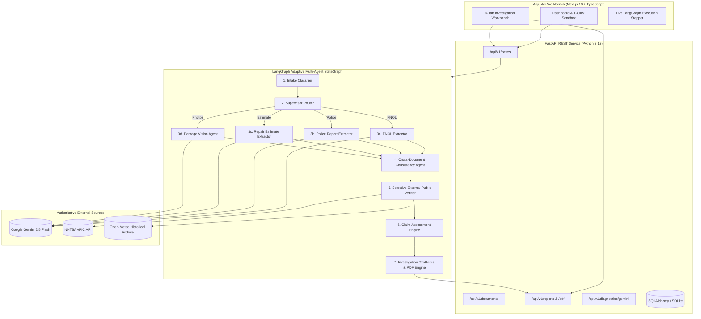

# ClaimScope — Enterprise Auto Accident Claim Investigation Assistant

<div align="center">


**An Adaptive, Multimodal Multi-Agent Decision-Support Platform for Property & Casualty (P&C) Automobile Claims Adjudication**

[Architecture](ARCHITECTURE.md) • [Research Summary](RESEARCH_SUMMARY.md) • [Evaluation Suite](EVALUATION.md) • [Demo Guide](DEMO_GUIDE.md) • [Responsible AI & Limitations](LIMITATIONS.md) • [Project Plan](PROJECT_PLAN.md)

</div>

---

## Executive Summary

**ClaimScope** is an enterprise-grade AI decision-support platform engineered specifically for Property & Casualty (P&C) automobile claims adjusters and Special Investigation Units (SIU). 

When a policyholder files a collision claim, adjusters often face an unstructured, inconsistent "incident package" consisting of First Notice of Loss (FNOL) forms, handwritten statements, official police collision reports, body shop repair estimates, and multi-angle scene photographs. Manually cross-referencing these documents to detect fraud, verify policy details, and validate damages is tedious, time-consuming, and error-prone.

ClaimScope transforms this workflow. Rather than acting as a generic chatbot or a rigid linear script, ClaimScope operates an **adaptive multi-agent system orchestrated via LangGraph**. It dynamically classifies incoming documents, selectively extracts structured facts, inspects photographic vehicle damage, detects cross-document contradictions, verifies facts against authoritative public registries (NHTSA and Open-Meteo), evaluates explainable risk rules, and compiles an evidence-backed institutional investigation report.

> [!IMPORTANT]
> **Human-in-the-Loop Decision-Support**: In compliance with the **NAIC Model Unfair Claims Settlement Practices Act (MDL-900)**, ClaimScope never autonomously denies a claim, revokes coverage, or issues legal fraud accusations. It assists licensed adjusters by surfacing verifiable facts, calculating explainable risk scores, and recommending next actions.

---

## Key Capabilities & Features

- **Public Showcase & Enterprise Homepage (`/`)**: Dedicated public homepage highlighting real multimodal capabilities, workflow architecture, interactive workbench preview, and responsible AI governance.
- **Operational Cockpit (`/dashboard`)**: Dedicated operational overview featuring live KPI metric cards, priority attention queue, priority distribution breakdown, and quick actions.
- **Full Case Management Registry (`/cases`)**: Multi-faceted search, status and priority filters, multi-column sorting, and pagination.
- **Agentic Engine Deep Dive (`/engine`)**: Detailed visual workflow of the 10-node LangGraph StateGraph, shared `CaseState` schema, and live case execution telemetry inspector.
- **Dedicated Investigation Registries**: Cross-case registries for **Document Intelligence** (`/documents`), **Evidence & Provenance Analysis** (`/evidence`), **Discrepancy Review** (`/discrepancies`), and **Investigation Reports Archive** (`/reports`).
- **Adaptive Multi-Agent Orchestration**: Dynamic LangGraph `StateGraph(CaseState)` workflow with supervisor routing that inspects package contents and conditionally executes only applicable extractors while gracefully logging skipped files.
- **Multimodal Document AI**: Native vector PDF parsing via PyMuPDF, paired with Google Gemini multimodal vision for scanned, handwritten, and photographic evidence.
- **Photographic Vehicle Damage Analysis**: Structured visual inspection extracting visible regions, affected components, severity ratings (`minor`, `moderate`, `severe`, `catastrophic_total_loss`), and explicit image quality limitations.
- **Cross-Document Discrepancy Engine**: Deterministic and semantic cross-referencing detecting direct liability contradictions (e.g., driver claims rear-ended while police cite head-on impact), vehicle identification mismatches (VIN/plate), and stated-versus-visible damage severity conflicts.
- **Selective External Grounding**: Real-time integration with authoritative public government databases without web scraping or fabricated search:
  - **NHTSA vPIC Government API**: Authoritative 17-character VIN decode (Make, Model, Year, Body Class, Plant Country) and check-digit validation.
  - **Open-Meteo Historical Weather Archive**: Hourly meteorological records matching accident timestamp and location coordinates.
  - **Collision Repair Benchmarks**: Regional labor rate and gross total cost range comparisons grounded against CCC ONE / Mitchell US national collision averages.
- **Explainable Assessment Engine**: Deterministic adjudication rules (`TRG-MAT-01` to `TRG-STR-08`) categorizing claims into standard adjuster triage tiers: `ROUTINE_REVIEW`, `ADDITIONAL_INFORMATION_REQUIRED`, or `ESCALATE_FOR_HUMAN_REVIEW`.
- **Institutional PDF Report Generator**: ReportLab-powered multi-page document export (`GET /api/v1/cases/{case_id}/report/pdf`) with official letterhead, summary matrices, and regulatory disclaimers.
- **1-Click Synthetic Incident Sandbox**: Dashboard cards allowing instant 1-click loading and examination of five representative scenarios (Cases A through E).
- **Interactive Adjuster Workbench**: 6 dedicated investigation tabs with deep evidence inspection (search, category filtering, conflict toggle, and provenance modal).

---

## System Architecture



---

## The 6-Tab Investigation Workbench

| Tab | Purpose & Features |
|---|---|
| **1. Incident Documents** | Multi-file drag-and-drop intake, classification badges, file size metadata, and manual document reprocessing triggers. |
| **2. Extracted Facts & Provenance** | Granular facts matrix with instant keyword search, category filter chips (`Vehicle`, `Incident`, `Parties`, `Coverage`, `Damages`), conflict-only toggle, and click-to-inspect provenance modal displaying source document, page, and extraction confidence. |
| **3. Vision Analysis** | Structured photo inspection displaying damage severity categories, damaged components, observable damage geometry, and image quality limitations. |
| **4. Cross-Document Discrepancies** | Side-by-side comparative cards highlighting conflicting statements between policyholder narratives, police reports, and damage photos with severity ratings (`CRITICAL`, `HIGH`, `MEDIUM`). |
| **5. External Grounding** | Live external public registry verifications (NHTSA VIN specifications, Open-Meteo weather corroboration, CCC/Mitchell collision repair benchmarks) with status badges (`VERIFIED`, `INCONCLUSIVE`, `SOURCE UNAVAILABLE`). |
| **6. Investigation Report** | Executive summary, triggered review rules (`TRG-MAT-01`, etc.), recommended adjuster action items, and 1-click **Download PDF** button. |

---

## Synthetic Demonstration Packages

ClaimScope includes five self-contained, realistic synthetic incident packages located in `backend/synthetic_packages/`:

| Package | Scenario Title | Files Included | Expected Investigation Behavior |
|---|---|---|---|
| **Case A** | *FNOL-Only Partial Package* | `incident_form.pdf` | **Adaptive Routing**: Supervisor skips absent extractors; flags `ADDITIONAL_INFORMATION_REQUIRED` due to pending body shop estimate. |
| **Case B** | *FNOL + Photographs Package* | `incident_form.pdf`<br>`damage_photo_front.png`<br>`damage_photo_wheel.png` | **Multimodal Vision**: Analyzes front bumper crease and wheel rim scuff; cross-references claimed impact point against photo evidence. |
| **Case C** | *Complete Consistent Package* | `incident_form.pdf`<br>`police_report.pdf`<br>`repair_estimate.pdf`<br>`rear_damage_photo.png` | **Full Multi-Agent Pipeline**: All 7 stages execute; mutually corroborated records; decodes VIN via NHTSA; `ROUTINE_REVIEW` outcome. |
| **Case D** | *Complete Package with Contradictions* | `incident_form.pdf`<br>`police_report.pdf`<br>`damage_photo_severe.png` | **SIU Fraud / Inconsistency**: Driver claims hitting deer at 21:00 with $500 scuff; police cite solid red light violation at 55mph broadsiding another vehicle with deployed airbags; VIN suffix mismatch; `ESCALATE_FOR_HUMAN_REVIEW` (`TRG-MAT-01`, `TRG-VIN-02`, `TRG-SEV-03`). |
| **Case E** | *Incomplete / Handwritten Sparse Package* | `scanned_handwritten_note.pdf` | **OCR & Non-Hallucination**: Minimal handwritten note; missing fields remain strictly null; flags `TRG-DOC-04` for missing core records. |

---

## Quantitative Benchmark Evaluation Suite

ClaimScope features an automated, reproducible benchmark evaluation runner (`backend/app/evaluation/`) validated against independently labelled ground-truth data:

```powershell
# Run the evaluation suite
python backend/scripts/run_evaluation.py
```

### Evaluation Results Summary

| Benchmark Metric | Evaluated Target | Score | Result |
|---|---|---|---|
| **Agent Routing Execution Accuracy** | Supervisor conditionally executing required extractors | **100.0%** | `[PASS]` |
| **Agent Routing Skip Accuracy** | Supervisor gracefully skipping absent document extractors | **100.0%** | `[PASS]` |
| **Human-Review Tier Agreement** | Assessment outcome matching expected adjuster tier | **100.0%** | `[PASS]` |
| **ReportLab PDF Stream Validity** | Multi-page PDF generation conforming to binary format | **100.0%** | `[PASS]` |
| **Report Schema Completeness** | All 11 institutional investigation sections populated | **100.0%** | `[PASS]` |
| **Evidence Traceability Score** | Proportion of extracted facts with source document citations | **100.0%** | `[PASS]` |
| **Live Multimodal Model Evaluation** | Real Gemini extraction precision, recall, and latency | *Pending Key* | `[NOT EVALUATED — AWAITING GEMINI_API_KEY]` |

*Note: Per specifications, live model metrics remain explicitly labelled `[NOT EVALUATED]` until a valid `GEMINI_API_KEY` is provided locally.*

---

## Installation & Quickstart

### Prerequisites
- **Python**: 3.12 or higher
- **Node.js**: 18.x or higher (tested on Node 25, npm 11)
- **Git**

### 1. Clone the Repository
```powershell
git clone https://github.com/vishnu2006/ClaimScopeVM.git
cd ClaimScopeVM
```

### 2. Backend Setup
```powershell
# Create and activate virtual environment (optional but recommended)
python -m venv venv
.\venv\Scripts\Activate.ps1

# Install dependencies
pip install -r backend/requirements.txt

# Configure environment
cp backend/.env.example backend/.env
```

### 3. Frontend Setup
```powershell
cd frontend
npm install
cd ..
```

---

## Gemini API Configuration & Connectivity Diagnostic

ClaimScope is designed to use **Google Gemini as its ONLY AI provider** and operates on the Gemini free tier.

### Where to Enter Your Gemini API Key:
Open `backend/.env` in any text editor and set your key:
```bash
GEMINI_API_KEY="AIzaSy...your-actual-gemini-key"
GEMINI_MODEL="gemini-2.5-flash"
```

### Run the Standalone Diagnostic Check:
Verify your configuration and test Gemini API connectivity with one command:
```powershell
python backend/scripts/check_gemini.py
```
- If the key is **not yet configured**, the diagnostic prints clear instructions without failing.
- If the key is **configured**, it tests an authenticated handshake with Gemini and confirms that all multimodal AI features are active.

---

## Running the Application

### Start the Backend Server (Terminal 1)
```powershell
$env:PYTHONPATH="c:\Users\vishn\Downloads\ClaimScopeVM\backend"; python -m uvicorn app.main:app --host 127.0.0.1 --port 8000 --reload
```
*API Swagger Documentation is available at [http://127.0.0.1:8000/docs](http://127.0.0.1:8000/docs).*

### Start the Frontend Dev Server (Terminal 2)
```powershell
cd frontend
npm run dev
```
*Open [http://localhost:3000](http://localhost:3000) in your browser.*

---

## Core API Reference

| Method | Endpoint | Description |
|---|---|---|
| `GET` | `/health` | Service health status and version. |
| `GET` | `/api/v1/diagnostics/gemini` | Gemini API connection test and diagnostic status. |
| `GET` | `/api/v1/cases` | List all investigation cases with document and evidence counts. |
| `POST` | `/api/v1/cases` | Create a new investigation case. |
| `GET` | `/api/v1/cases/{id}` | Get complete case detail with documents, evidences, and reports. |
| `POST` | `/api/v1/cases/synthetic/{scenario_id}` | 1-click load of synthetic test packages (`case_a` through `case_e`). |
| `POST` | `/api/v1/cases/{id}/investigate` | Trigger LangGraph adaptive investigation workflow. |
| `GET` | `/api/v1/cases/{id}/investigation` | Get current LangGraph execution state and agent execution records. |
| `GET` | `/api/v1/cases/{id}/report/pdf` | Stream official ReportLab multi-page investigation PDF report. |
| `POST` | `/api/v1/cases/{id}/documents` | Multipart upload for incident files (PDF, PNG, JPG). |

---

## Project Documentation Sitemap

For in-depth architectural, research, and evaluation details, consult our dedicated project deliverables:

- **[`PROJECT_PLAN.md`](PROJECT_PLAN.md)**: Final implementation status and five-stage development roadmap.
- **[`ARCHITECTURE.md`](ARCHITECTURE.md)**: Deep dive into the LangGraph StateGraph, schemas, and security architecture.
- **[`RESEARCH_SUMMARY.md`](RESEARCH_SUMMARY.md)**: Authoritative insurance research (NAIC MDL-900, ACORD 1, NICB, NHTSA, CCC ONE).
- **[`EVALUATION.md`](EVALUATION.md)**: Benchmark evaluation methodology, ground truth data, and metric definitions.
- **[`DEMO_GUIDE.md`](DEMO_GUIDE.md)**: Step-by-step presentation walkthrough script for evaluators and judges.
- **[`LIMITATIONS.md`](LIMITATIONS.md)**: Responsible AI boundaries, NAIC compliance, and physical damage limits.
- **[`backend/synthetic_packages/README.md`](backend/synthetic_packages/README.md)**: Detailed breakdown of Cases A through E.

---

## License

This project is licensed under the MIT License — see the [LICENSE](LICENSE) file for details.
