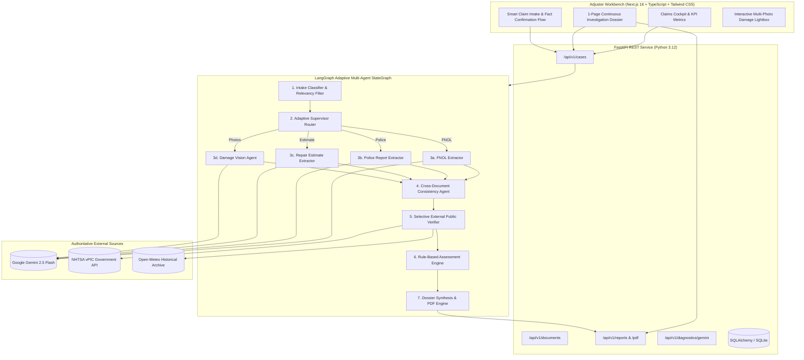

# ClaimScope — Enterprise Auto Accident Claim Investigation Assistant

<div align="center">


**An Adaptive, Multimodal Multi-Agent Decision-Support Platform for Property & Casualty (P&C) Automobile Claims Adjudication**

[Live Web Demo](https://claimscope.vercel.app) • [Architecture](ARCHITECTURE.md) • [Research Summary](RESEARCH_SUMMARY.md) • [Evaluation Suite](EVALUATION.md) • [Demo Guide](DEMO_GUIDE.md) • [Responsible AI & Limitations](LIMITATIONS.md)

</div>

---

## Executive Summary

**ClaimScope** is an enterprise-grade AI decision-support platform engineered specifically for Property & Casualty (P&C) automobile claims adjusters and Special Investigation Units (SIU). 

When a policyholder files a collision claim, adjusters face an unstructured, inconsistent "incident package" consisting of First Notice of Loss (FNOL) forms, handwritten statements, official police collision reports, body shop repair estimates, and multi-angle scene photographs. Manually cross-referencing these documents to detect fraud, verify policy details, and validate damages is tedious, time-consuming, and error-prone.

ClaimScope transforms this workflow into an intuitive, automated experience. Rather than acting as a generic chatbot or a rigid linear script, ClaimScope operates an **adaptive multi-agent system orchestrated via LangGraph**:
1. **Dynamic Content Classification & Multimodal Ingestion**: Ingests digital PDFs via PyMuPDF and scanned/photographic materials via Google Gemini 2.5 Flash Multimodal OCR.
2. **Relevance & Guardrail Verification**: Evaluates submitted visual evidence with strict insurance guardrails, automatically recognizing and filtering non-claim imagery (e.g. sports stadiums, memes, food, landscapes) without false-positive damage classifications.
3. **Structured Fact Extraction with Provenance**: Extracts field-level insurance entities (VIN, Policy, Loss Date/Time, Location, Parties, Repair Totals) with verifiable source document citations and exact text snippets.
4. **Computer Vision Damage Appraisal**: Inspects vehicular damage across multiple camera angles, mapping visible impact regions, affected body components, and apparent severity against institutional insurance rubrics.
5. **Cross-Document Discrepancy Detection**: Deterministically and semantically cross-references accounts to flag direct factual contradictions (e.g., driver claims rear-end strike vs police report citing head-on impact, loss timing disparities, or VIN suffix mismatches).
6. **Authoritative Public Registry Grounding**: Validates facts against real government APIs—verifying 17-character VINs via **NHTSA vPIC**, corroborating weather conditions via the **Open-Meteo Historical Archive**, and comparing repair totals against national labor averages.
7. **Human-in-the-Loop Decision Dossier & ReportLab PDF Export**: Compiles an executive investigation dossier adhering strictly to NAIC MDL-900 guidelines with high-resolution photographic evidence tables and 1-click court-ready PDF generation.

> [!IMPORTANT]
> **Human-in-the-Loop NAIC MDL-900 Compliance**: ClaimScope never autonomously denies a claim, cancels coverage, or issues criminal fraud accusations. It serves as an objective, explainable decision-support assistant for licensed claims adjusters.

---

## 🌟 Key Innovations & Live Experience

### 1. Unified Single-Page Investigation Dossier
The flagship investigation workbench has been redesigned from fragmented multi-tab subpages into an enterprise 1-page continuous investigation dossier:
- **Hero Collision Evidence Gallery**: Primary photographic collision evidence embedded with inline zoom and multi-photo carousel navigation.
- **Evidence-Adjacent Contradiction Cards**: Discrepancies presented side-by-side with source quotations and direct links to view the original PDF document.
- **Interactive Multi-Photo Lightbox**: Full-resolution damage inspection with zoom controls and keyboard navigation.

### 2. Intelligent Multimodal Vision & Content Relevance Filtering
- **Non-Relevant Image Detection**: If an unrelated photo (e.g. a cricket stadium, food, or landscape) is submitted, ClaimScope's vision agent immediately identifies it as non-claim content (`is_claim_relevant: false`, `severity: not applicable`) instead of hallucinating bumper damage.
- **Explainable Severity Grading**: Vehicles with verifiable damage are graded on a structured rubric (`minor`, `moderate`, `severe`, `catastrophic_total_loss`) with explicit notes on physical limitations.

### 3. End-to-End Extraction from Real-World Packages
- **Zero Hardcoded Data**: Replaces mock defaults with live dynamic extraction synthesized across all submitted claim records.
- **Interactive Intake Confirmation**: The new claim flow auto-extracts incident details from uploaded files, allowing adjusters to review, edit, or resolve conflicting facts before creating the claim.
- **Real Collision Packages Included**: Comes pre-packaged with real-world collision test cases (`real_demo/`):
  - **Case 1 (Consistent Rear-End)**: 5 documents + real vehicle photo corroborating a clean third-party impact (`ROUTINE_REVIEW`).
  - **Case 2 (Conflicting Frontal Impact)**: 5 documents + photo with 4 intentional discrepancies (3-hour loss time disparity, left-vs-right impact contradiction, and VIN suffix mismatch) demonstrating instant SIU escalation (`ESCALATE_FOR_HUMAN_REVIEW`).

---

## System Architecture



---

## Demonstration Cases

ClaimScope includes ready-to-test demonstration cases located in `real_demo/` and `backend/synthetic_packages/`:

| Package | Scenario Title | Files Included | Core Demonstrated Capability |
|---|---|---|---|
| **Real Case 1** | *Clean Rear-End Collision* | `01_FNOL_Incident_Report.pdf`<br>`02_Police_Collision_Report.pdf`<br>`03_Repair_Estimate_ApexAutoBody.pdf`<br>`04_Claimant_Recorded_Statement.pdf`<br>`05_Witness_Statement_ElenaRostova.pdf`<br>`photos/photo_1_rear_impact.jpg` | **Full Alignment**: 100% corroborated facts across all documents and scene photograph; 0 discrepancies; `ROUTINE_REVIEW` recommendation. |
| **Real Case 2** | *Disputed Frontal Crash & VIN Conflict* | `01_FNOL_Incident_Report.pdf`<br>`02_Police_Collision_Report.pdf`<br>`03_Repair_Estimate_SiliconValleyBody.pdf`<br>`04_Claimant_Recorded_Statement.pdf`<br>`05_Witness_Statement_ChevronStation.pdf`<br>`photos/photo_1_front_left_damage.jpg` | **SIU Contradiction Engine**: Catches 3-hour loss time disparity, left-vs-right impact direction mismatch, and VIN suffix discrepancy; `ESCALATE_FOR_HUMAN_REVIEW`. |
| **Non-Claim Test** | *Irrelevant Image Ingestion* | Non-vehicular photo (e.g. cricket stadium, meme, landscape) | **Relevance Guardrail**: Categorized as `Not Relevant: Non-vehicular content`, preventing hallucinated damage ratings. |

---

## Installation & Local Development

### Prerequisites
- **Python**: 3.12 or higher
- **Node.js**: 18.x or higher
- **Git**

### 1. Clone & Set Up Virtual Environment
```powershell
git clone https://github.com/vishnu2006/ClaimScopeVM.git
cd ClaimScopeVM

# Create Python virtual environment
python -m venv venv
.\venv\Scripts\Activate.ps1

# Install backend dependencies
pip install -r backend/requirements.txt
```

### 2. Configure Environment Variables
Copy `.env.example` to `backend/.env` and add your **Google Gemini API Key**:
```bash
GEMINI_API_KEY="AIzaSy...your-actual-gemini-key"
GEMINI_MODEL="gemini-2.5-flash"
```

Verify your Gemini connectivity in one command:
```powershell
python backend/scripts/check_gemini.py
```

### 3. Frontend Setup
```powershell
cd frontend
npm install
cd ..
```

### 4. Running the Application
- **Backend Server (Terminal 1)**:
  ```powershell
  $env:PYTHONPATH="backend"; python -m uvicorn app.main:app --host 127.0.0.1 --port 8000 --reload
  ```
- **Frontend Server (Terminal 2)**:
  ```powershell
  cd frontend
  npm run dev
  ```
- Open [http://localhost:3000](http://localhost:3000) in your browser.
- Interactive Swagger API docs are available at [http://127.0.0.1:8000/docs](http://127.0.0.1:8000/docs).

---

## Testing & Quality Assurance

ClaimScope includes a full automated test suite covering authentication, document classification, multimodal extraction, deterministic discrepancy detection, and ReportLab PDF generation:

```powershell
.\venv\Scripts\pytest backend/tests/ -v
```
**Test Results**: `37 / 37 Tests Passing [100%]`

---

## Core API Reference

| Method | Endpoint | Description |
|---|---|---|
| `GET` | `/health` | Health check and version telemetry. |
| `GET` | `/api/v1/cases` | List all claims with metadata and document counts. |
| `POST` | `/api/v1/cases` | Create a new claim package. |
| `POST` | `/api/v1/cases/{id}/documents` | Upload and classify claim documents & photos. |
| `POST` | `/api/v1/cases/{id}/investigate` | Execute the LangGraph adaptive multi-agent pipeline. |
| `GET` | `/api/v1/cases/{id}/investigation` | Retrieve the real-time execution state and facts. |
| `GET` | `/api/v1/cases/{id}/report/pdf` | Stream court-ready ReportLab investigation PDF brief. |
| `GET` | `/api/v1/diagnostics/gemini` | Gemini API connection test and operational telemetry. |

---

## License

This project is licensed under the MIT License — see the [LICENSE](LICENSE) file for details.
